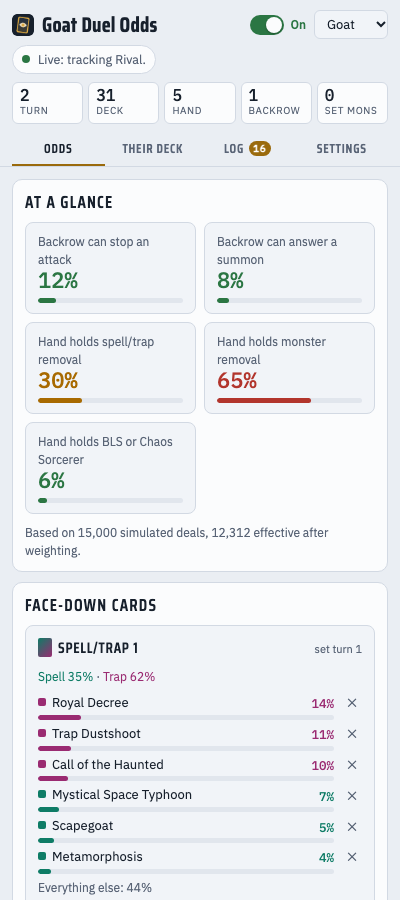
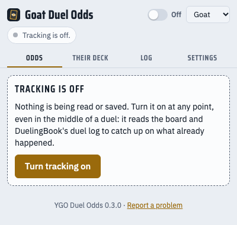
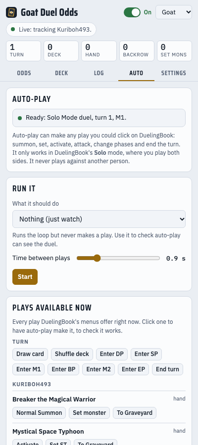

# YGO Duel Odds

A helper for playing Yu-Gi-Oh! **Goat** and **Edison** format on [DuelingBook](https://www.duelingbook.com/). It sits next to your duel and shows the odds for what your opponent might have: each face-down card, their hand, their next draw, and which deck they're playing. It updates on its own as you play. You don't have to type anything in.



### [⬇ Download YGO Duel Odds](https://github.com/Kuriboh493/ygo-duel-odds/releases/latest/download/ygo-duel-odds.zip)

For Chrome, Edge, Brave, Opera, Vivaldi and Firefox. Using Safari on a Mac? [Download the Safari version](https://github.com/Kuriboh493/ygo-duel-odds/releases/latest/download/ygo-duel-odds-safari.zip) instead.

Then follow the [install steps](#install-it-about-5-minutes) below. It takes about 5 minutes.

It only uses what both players can see on screen. It never peeks at your opponent's hidden cards. Some tournaments don't allow helper tools, so check the rules before using it in an event.

- [Install it (about 5 minutes)](#install-it-about-5-minutes)
- [Use it](#use-it)
- [Turning it on partway through a duel](#turning-it-on-partway-through-a-duel)
- [Auto-play (Solo Mode)](#auto-play-solo-mode)
- [Bot account: playing people who choose to play a bot](#bot-account-playing-people-who-choose-to-play-a-bot)
- [Something not working?](#something-not-working)
- [What it can and can't see](#what-it-can-and-cant-see)
- [For developers](#for-developers)

## Install it (about 5 minutes)

It works in **Chrome, Edge, Brave, Opera, Vivaldi**, **Firefox** and **Safari** on a Mac. Safari has [its own steps](#safari-on-a-mac). It isn't in any browser's add-on store yet, so there's no one-click install. You download a folder and point your browser at it, and the steps below walk through that.

### Step 1: Download it

1. Click this link: **[Download YGO Duel Odds](https://github.com/Kuriboh493/ygo-duel-odds/releases/latest/download/ygo-duel-odds.zip)**. A file called `ygo-duel-odds.zip` downloads, usually into your Downloads folder.
2. Unzip it:
   - **Windows:** right-click the file, choose **Extract All**, then **Extract**.
   - **Mac:** double-click the file.
3. You now have a folder called `ygo-duel-odds`. Leave it somewhere you won't delete it, like your Documents folder: the browser runs the extension from this folder.

### Step 2: Add it to your browser

**Chrome, Edge, Brave, Opera or Vivaldi**

1. Open a new tab and type the address for your browser into the address bar, then press Enter:
   - Chrome: `chrome://extensions`
   - Edge: `edge://extensions`
   - Brave: `brave://extensions`
   - Opera: `opera://extensions`
   - Vivaldi: `vivaldi://extensions`
2. Turn on **Developer mode**. It's a switch in the top-right corner of the page. In Edge it's on the left.
3. Click **Load unpacked**.
4. Find the **`ygo-duel-odds`** folder, click it once, and click **Select** (or **Open**).
5. "YGO Duel Odds" now appears in the list. It may show a yellow "warnings" note. That's expected and safe to ignore.
6. Pin it so it's easy to find. Click the puzzle-piece icon next to the address bar, then the pin next to "YGO Duel Odds". Its icon is a card with an eye on it.

**Firefox** (version 128 or newer)

1. Type `about:debugging#/runtime/this-firefox` into the address bar and press Enter.
2. Click **Load Temporary Add-on…**.
3. Open the `ygo-duel-odds` folder and pick the file called **`manifest.json`**.
4. Firefox only keeps add-ons installed this way until you close Firefox. Each time you reopen it, repeat these three steps.

**Safari:** see [Safari on a Mac](#safari-on-a-mac) below. It has its own download.

### Step 3: Open the panel

1. Go to [duelingbook.com](https://www.duelingbook.com/). If it was already open, reload the page so the extension can start.
2. Click the extension's icon, the card with an eye. A panel opens on the side of the window. In Firefox it's the sidebar. In browsers without a side panel, it opens as a small window.
3. **Firefox only:** if the panel says it can't see DuelingBook, click **Allow access to DuelingBook**, then reload the DuelingBook page.
4. Pick **Goat** or **Edison** from the menu in the top-right of the panel.

That's it. Start or watch a duel and the panel fills in by itself.

### Safari on a Mac

Safari installs extensions as a small Mac app. This one isn't signed with a paid Apple developer account, so macOS and Safari each ask you to confirm it once. You also have to tick one Safari setting each time you open Safari.

1. **Download:** [Download the Safari version](https://github.com/Kuriboh493/ygo-duel-odds/releases/latest/download/ygo-duel-odds-safari.zip). A file called `ygo-duel-odds-safari.zip` downloads. Double-click it to unzip it.
2. **Move it:** drag **YGO Duel Odds** (the app) into your **Applications** folder.
3. **Open the app once.** macOS will say it can't check the app for malicious software, because it isn't signed. To open it anyway:
   - **macOS 14 (Sonoma) or older:** hold **Control**, click the app, choose **Open**, then click **Open** again.
   - **macOS 15 (Sequoia) or newer:** double-click the app and close the warning. Open **System Settings** > **Privacy & Security**, scroll down, and click **Open Anyway** next to "YGO Duel Odds". Enter your password if asked.

   A small window opens. It's only the installer, so you can close it.
4. **Turn on unsigned extensions in Safari.**
   - Open **Safari** > **Settings** > **Advanced** and tick **Show features for web developers**.
   - A **Developer** tab appears in Settings. Open it and tick **Allow unsigned extensions**, then enter your password. On Safari 16 or older, this is in the **Develop** menu instead.
5. **Turn the extension on:** in Safari's **Settings** > **Extensions**, tick **YGO Duel Odds**.
6. **Allow it on DuelingBook:** go to [duelingbook.com](https://www.duelingbook.com/), click the extension's icon in the toolbar, and choose **Always Allow on This Website**.
7. **Open the panel:** click the icon again. In Safari, the panel opens in its own small window. Put it next to your DuelingBook window.

**Each time you reopen Safari**, it switches off "Allow unsigned extensions" again, so repeat step 4. The extension stays installed, and turns back on when you tick that box. Only an extension signed through Apple's paid developer program avoids this step.

## Use it

### The on/off switch

The switch at the top of the panel turns tracking on and off.

- **On** (green): it follows the duel and keeps the odds up to date.
- **Off** (grey): it reads nothing and saves nothing. The toolbar icon shows **OFF**, so you can tell at a glance.



You can switch it on whenever you like, including in the middle of a duel. See [Turning it on partway through a duel](#turning-it-on-partway-through-a-duel).

### The four tabs

- **Odds**: what you need mid-duel.
  - **At a glance** has the big risks: whether their face-down spells or traps can stop an attack or answer a summon, and whether their hand holds removal.
  - **Face-down cards** lists each card they've set, with the cards it's most likely to be.
  - **Their hand** lists what they're likely holding. Cards you saw them add to their hand are marked "known".
  - **Their next draw** lists the cards they're most likely to draw next.
- **Their deck**: the deck they're most likely playing, the cards it usually runs, and a place to paste their decklist if you have it.
- **Log**: everything the extension has noticed, in order, newest first. The number on the tab counts new entries.
- **Auto**: [auto-play](#auto-play-solo-mode), which can make plays for you in Solo Mode.
- **Settings**: the "no response" options, tracking options, and **Report a problem**.

### Reading the numbers

- **"Royal Decree 14%"** under a face-down card means: out of every 100 situations that match everything seen so far, that card is Royal Decree in about 14.
- **"Holds one+ 25%"** in their hand means a 1-in-4 chance they're holding at least one copy.
- **Red** means likely, **orange** means maybe, and **green** means unlikely.

The numbers sharpen as the duel goes on and they show more of their deck.

### "What they didn't do"

When you attack, summon, or activate a spell or trap and your opponent doesn't respond, that's a clue. They probably don't have a card that would have stopped it. The extension notices this by itself and lowers the odds of those cards. The adjustment appears as a small tag under the face-down card, such as "Auto: Ignored an attack 70%".

- To undo one, click its tag.
- To rule out a card for one face-down card, click the **✕** next to that card.
- The buttons under **What they didn't do** on the Odds tab are for things the extension can't see, like "Left my backrow alone".
- You can turn the automatic version off, or make it stronger or weaker, in **Settings**.

### If you know their decklist

You don't need it, because the extension guesses their deck as they play. If you do have it:

1. Open the **Their deck** tab and click **Opponent decklist**.
2. Paste the list, one card per line (like `3 Book of Moon`), or click **Open a .ydk or text file**.
3. Click **Load list**.

To go back to guessing, choose **Guess it from what they play** in the same place.

## Turning it on partway through a duel

Switch it on at any point, or open the panel mid-duel, and it catches up by itself:

1. It reads the board as it is right now: their hand and deck size, every face-down card, and everything in the graveyard and banished.
2. It reads DuelingBook's own **Duel Log** for this game. Any card your opponent showed earlier counts as part of their deck. A card they added to their hand, and haven't used since, is marked as probably still in their hand.
3. The earlier plays show up in the **Log** tab, marked "Earlier".

There are two things it can't recover from before you switched it on:

- **"No response" moments.** It doesn't know which of your attacks they let through earlier. You can add these by hand with the buttons under **What they didn't do**.
- **Earlier face-down cards.** It doesn't know whether a card in their hand was once set face-down.

A note at the top of the Odds tab tells you when this happens.

## Auto-play (Solo Mode)

The **Auto** tab can make plays on DuelingBook for you: draw, summon, set, activate, attack, change phases and end the turn. It makes them through DuelingBook's own menus, exactly as if you'd clicked them.



**It only works in DuelingBook's Solo Mode**, where you play both sides yourself. In any duel against another person, it's locked and refuses every play. Having a program play for you against someone who thinks they're playing you would be unfair to them, and DuelingBook treats outside help as cheating.

Under **What it should do** you can choose:

- **Learned model (plays like you)**: makes the plays a model trained on your own recorded duels thinks you'd make. See [Teaching it to play like you](#teaching-it-to-play-like-you).
- **Nothing (just watch)**: runs but never plays. Use it to check that auto-play can see the duel.
- **Test: draw, then end the turn**: on player 1's turns it draws a card and ends the turn, to check that plays go through.

To try it:

1. On DuelingBook, start a **Solo Mode** duel.
2. Open the **Auto** tab. The box at the top should say **Ready: Solo Mode duel**.
3. Under **Plays available now**, click any play. Auto-play makes it on DuelingBook, so you can see it working.
4. Or pick a setting under **What it should do**, choose how long to wait between plays, and press **Start**. Press **Stop** at any time.

Everything it does is listed under **What it did**.

### Teaching it to play like you

The learned model copies your decisions. You record your own duels, train a model on your computer, and load it back into the extension. It learns from what you did in each situation, so the more duels you record, the better it gets. It isn't a general Yu-Gi-Oh! AI: it can only make the kinds of plays it has seen you make.

**1. Record your plays.** In the **Auto** tab, under **Learning**, turn on **Record my plays for training**. Then play duels as normal, in any mode. Each play you make is saved on your computer, along with the situation you made it in: your cards, and whatever both players could see of your opponent's. It never saves your opponent's hidden cards. The count under the switch shows how many plays are saved. A few hundred plays is a start, and a few thousand is better.

**2. Download them.** Press **Download training data**. A file called something like `ygo-training-data-2026-10-29.json` downloads.

**3. Train the model.** This needs Python 3, which Macs and most Linux computers already have. On Windows, install it from [python.org](https://www.python.org/downloads/). The trainer isn't in the extension download, so get the full project too: [download it from GitHub](https://github.com/Kuriboh493/ygo-duel-odds/archive/refs/heads/main.zip) and unzip it. Open a terminal in that `ygo-duel-odds-main` folder and run:

```
python3 tools/train_policy.py ~/Downloads/ygo-training-data-2026-10-29.json
```

It takes a few seconds to a few minutes. When it finishes, it tells you how often the model picked the play you actually made, in duels it didn't train on, and how that compares to guessing. It writes a file called `policy.json`.

**4. Load it.** Under **Learning**, press **Load a trained model** and pick `policy.json`. Then choose **Learned model** under **What it should do**, start a Solo Mode duel, and press **Start**.

**No recordings yet?** Load the ready-made starter model, `models/goat-starter.json`, from the [full project download](https://github.com/Kuriboh493/ygo-duel-odds/archive/refs/heads/main.zip). It was trained on 500 simulated games, and in 300 test games against the scripted player it won 107 and lost 152, with 41 reaching the turn limit. Or train your own from simulated games. `tools/sim_goat.py` deals games between four standard Goat decks:

- Chaos Control, from flosel74's winning list at the 2026 World Championship
- Gumo Warrior, from Ez2Slayu's 2nd-place list
- Warrior, from Leuh's top 4 list
- Chaos Turbo, from Joker88's list that won Last Chance Qualifier 3 2026

A scripted player plays them using common rules of thumb, and the model learns those habits:

```
python3 tools/sim_goat.py --games 500 -o sim-training.json
python3 tools/train_policy.py sim-training.json
```

It plays sensibly but simply, because it can only learn what the script does. A model trained on your own duels will play more like you. You can also train on both files at once.

To see how a model plays, rather than how often it copies, test it against the scripted player:

```
python3 tools/sim_goat.py --eval --games 300 --model policy.json
```

Some safety rules always apply when it plays:

- It never makes a kind of play it has never seen you make.
- It makes each card's play at most once per turn, so each monster attacks at most once.
- Once it ends its turn, it waits for the next one, and it ends the turn after 40 plays.

Under **Which side it plays**, choose whether it plays only player 1, or both sides against itself.

## Bot account: playing people who choose to play a bot

Auto-play can also duel real people, but only people who know they're playing a program. It runs on a separate DuelingBook account set up as a bot:

- **It's labeled.** The account's name must contain "bot", and its profile should say it's a bot and who runs it.
- **Opponents opt in.** It hosts its own unrated duels titled "🤖 BOT: you'll be playing YGO Duel Odds, a computer program. Unrated." It only plays people who join one of those duels.
- **It tells them in chat.** Before its first play of each game, it posts: "Hi! I'm a bot: a computer program trained to play this format, run by its owner to test it."
- **It never plays rated duels**, and never joins the matchmaking pools.
- **It only plays its own cards, on its own turn.**

If any of these isn't true, it refuses to make a play. For example, if you accept a pool duel or a challenge on the bot account yourself, it stays locked, because that opponent never saw its label.

Bots aren't covered by DuelingBook's rules either way, so ask DuelingBook's staff before running one. It's their site, and an account they don't approve of can be banned.

To run it:

1. Make a DuelingBook account for the bot, with "bot" in its name and a profile that says it's a bot run by you.
2. Ask DuelingBook's staff if it's OK.
3. Log in as the bot in DuelingBook. Open the **Duel Room** and pick the bot's deck there.
4. In the panel, open the **Auto** tab and go to **Bot account**. Tick the three confirmations, then turn on **Bot account mode**. Tick **Host again after each duel** if you want it to keep going.
5. Press **Host a bot duel**. It hosts an unrated Goat match (or Edison, if Edison is picked at the top).
6. Under **Run it**, choose **Learned model**, and press **Start**.

From there it handles each duel itself: it accepts the first person who joins, plays rock-paper-scissors, goes first when it wins, posts its announcement, plays its turns with the model, and keeps its deck as it is between games. Keep the panel open while it runs. Everything it does is listed under **What it did**.

## Something not working?

| What you see | What to do |
|---|---|
| "Looking for a DuelingBook tab…" | Open [duelingbook.com](https://www.duelingbook.com/) in the same browser window. If it's already open, reload it. |
| "Connected… Waiting for a duel to start" | This is normal until a duel begins. Start or watch a duel. |
| "Tracking is off" | Flip the switch at the top of the panel to **On**. |
| "The extension can't see DuelingBook yet" (Firefox) | Click **Allow access to DuelingBook**, then reload the DuelingBook page. |
| "Duel events aren't coming through" | DuelingBook may have updated. The board is still read, but "no response" isn't logged automatically. Please [report it](#reporting-a-problem). |
| The extension disappeared (Safari) | Safari turns off unsigned extensions whenever it quits. In Safari's **Settings** > **Developer**, tick **Allow unsigned extensions** again ([step 4](#safari-on-a-mac)). |
| The extension disappeared (Firefox) | Firefox removes add-ons installed this way when it closes. Repeat [Step 2](#step-2-add-it-to-your-browser). |
| I want the newest version | Download it again from the [download link](https://github.com/Kuriboh493/ygo-duel-odds/releases/latest/download/ygo-duel-odds.zip), replace your old `ygo-duel-odds` folder with the new one, then click the circular-arrow **reload** button on the extension in your browser's extensions page. |
| The numbers look wrong | Open **Settings** and click **Restart tracking from the current board**. If it's still wrong, [report it](#reporting-a-problem). |
| The panel is blank or stuck | Close the panel and open it again. If that doesn't help, reload DuelingBook. |

### Reporting a problem

Click **Report a problem** at the bottom of the panel.

1. Describe what went wrong in a sentence or two.
2. Check what's attached. It's a summary of what the extension saw: versions, recent errors and the last few plays. Player names are swapped for "Me" and "Opponent" unless you untick that box.
3. Choose how to send it:
   - **Open a GitHub issue**: opens a filled-in report on the project page. Read it, then press **Submit**. You need a free GitHub account.
   - **Copy report**: copies it so you can paste it into a message to whoever gave you the extension.
   - **Download report**: saves it as a file you can send.

Nothing is sent until you do one of these.

## What it can and can't see

It reads only what DuelingBook shows to both players:

- How many cards your opponent has in their hand and deck.
- Every face-down card's position.
- Every card that's face-up, in the graveyard or banished.
- Cards they reveal, or add to their hand where both players can see them, such as a search.
- DuelingBook's public duel log.

It never reads the names of cards in your opponent's hand, or of face-down cards that haven't been shown to both players. It doesn't read passwords, account details or private messages. Everything stays in your browser, except the decks from your past duels, which it keeps on your computer to make better guesses.

How the deck guess works: the extension learned what Goat and Edison decks look like from about 3,500 decklists that placed in tournaments, plus about 2,500 decklists people have posted online. Tournament decks count the most. During a duel, every card your opponent shows narrows down which of those decks they're likely playing. Decks you've faced before count too, and an earlier game against the same opponent counts the most.

## For developers

### What's in the repository

| Path | What it is |
|---|---|
| `extension/` | The browser extension (Manifest V3: Chromium, Firefox 128+, and Safari through `tools/build_safari.sh`). |
| `goat-odds.html`, `edison-odds.html` | The original single-page calculators. You log what the opponent does by hand. Open either in a browser, with `cards.js` in the same folder. Keyboard shortcuts: D draw, S set spell/trap, M set monster, E end turn, Z undo. |
| `cards.js` | Card database built from the YGOPRODeck API. `extension/cards.js` is a copy. |
| `tools/build_cards.py` | Builds `cards.js`. |
| `tools/train_decks.py` | Learns the deck archetypes in `extension/learned.js`. |
| `tools/make_icons.py` | Draws the toolbar icons. |
| `tools/build_safari.sh` | Builds the Safari app with Xcode. The GitHub workflows run it on a macOS runner. |
| `tools/train_policy.py` | Trains the auto-play model from recorded decisions. |
| `tools/test_features.py` | Checks that the Python and JavaScript copies of the model's features match. |
| `tools/sim_goat.py` | A simplified Goat simulator that writes training decisions from a scripted player, and tests a trained model against that player. |
| `tools/decks/` | The four standard decklists the simulator uses. Add more `.txt` lists in the same format and it uses them too. |
| `models/goat-starter.json` | A model trained on simulated games with those decks, ready to load in the Auto tab. |

### How the extension works

- **`page-hook.js`** runs in DuelingBook's page context. It wraps the client's `duelResponse()`, through which every duel event passes, and reads the board from the client's `player1` and `player2` objects. It passes on only public information: names of face-up and revealed cards, never names from hand or face-down cards. It also returns the public text of the client's `duel_logs` when asked.
- **`tracker.js`** is a content script. It keeps the public identity of each card instance and the numbering of face-down cards. It detects "no response" by opening a window after your attack, summon or spell/trap activation, which closes on your next action or on any play by the opponent. When tracking starts partway through a duel, it catches up from `duel_logs`:
  - Every quoted card name in the opponent's lines is counted as at least one copy in their deck. Lines about targeting or attacking are skipped, because they name the other player's cards.
  - A card sent "to hand" and not mentioned since is softly marked as known in their hand. The mark moves off when they play a copy of it.
- **`panel.js`** runs the model and draws the panel.
  - With no decklist, the opponent's deck is a mixture of archetypes from `learned.js` and decks from your past duels. Each archetype gives every card a distribution over 0–3 copies.
  - Each card shown reweights the archetypes and updates copy counts through a binomial model of how much of the deck has been seen.
  - Each of 15,000 simulated deals samples a whole deck, conditioned on the deck size DuelingBook shows. It then deals the hidden cards with importance weights from the face-down and hand evidence.
- **Auto-play** has two halves:
  - `page-hook.js` is the executor. It lists the plays on offer by running the client's own menu builders (`cardMenuE`, `showDeckMenu`) with `showMenu` briefly swapped for a recorder, so nothing appears on screen. It makes a play the way a click does, through `cardMenuClicked`. Attacks on a monster go through `Send` with the chosen target, and phase plays use `Send` directly.
  - The executor refuses anything that isn't on that card's menu right now, and anything less than 300 ms after its last play. Outside Solo Mode, it refuses everything unless bot account mode's conditions all hold:
    - The account's name contains "bot".
    - The duel is unrated (`rated === false`).
    - The opponent joined a duel the bot hosted under its label. `joinDuelResponse` is wrapped to accept joiners and record them.
    - The bot's announcement has been sent for this game.

    In bot duels it only plays its own cards on its own turn. The hook also answers rock-paper-scissors, picks first and confirms side decking, all through the client's own `chooseRPS`, `pickFirst`, `doneSiding` and `hostDuel`.
  - When recording is on, `page-hook.js` builds a decision record just before the client applies each of your plays. The record holds:
    - your cards with names and stats
    - the opponent's public cards, plus counts of their hidden ones
    - the turn, phase, and how many plays and summons you've made this turn
    - every candidate play, with a key
    - which candidate you chose

    `tracker.js` stores the records in chunks, capped at 40,000.
  - `features.js` turns a record into features for each candidate: the play type crossed with the phase, zone, card name, hand size, board counts and life points, plus battle outcome for attacks. `tools/train_policy.py` has a line-for-line Python copy, and `tools/test_features.py` checks the two agree using macOS's JavaScript engine. Records keep the raw situation rather than features, so the features can change without re-recording. Bump `FEATURES_VERSION` in both when they do.
  - `train_policy.py` fits a linear softmax ranker over each decision's candidates with AdaGrad and L2, holding out 20% of duels. It reports top-1 and top-3 accuracy against random and most-common-play baselines, then refits on everything and exports the weights. No packages are needed.
  - `tools/sim_goat.py` simulates games with the lists in `tools/decks/`:
    - It models turns, tributes, battle and the effects of the cards in those decks, simplified.
    - It handles DuelingBook's manual follow-ups, like the two draws after Pot of Greed and the discards after Graceful Charity.
    - The defending player's traps follow fixed habits.
    - The scripted player's decisions are written as records, with candidates named as DuelingBook's menus name them.
    - `--model policy.json --eval` plays the trained model against the scripted player, using the same guards as the extension, and reports the win rate.

    It's a rough model of the game, not a rules engine: chains are one link deep, and effects outside those decks do nothing.
  - `autoplay.js` runs the loop in the panel. A strategy is an entry in `STRATEGIES` with a `decide(state)` function that returns an action or `null`. The comment at the top of the file lists what `state` holds and what an action looks like.
- **`report.html`** gathers diagnostics from the panel and the DuelingBook tab, and opens a prefilled GitHub issue.

If DuelingBook changes its client, the panel says duel events aren't coming through. Board reading may keep working in that case.

### Releasing a new version

1. Raise `version` in `extension/manifest.json`, for example to `0.3.1`, and commit.
2. Tag and push: `git tag v0.3.1 && git push origin v0.3.1`.

The `Release` GitHub workflow checks that the tag matches the manifest. It then attaches two files to a release for that tag: `ygo-duel-odds.zip`, which is `extension/` zipped, and `ygo-duel-odds-safari.zip`, the Safari app built on a macOS runner. The README's download links always point at the newest release. The `Safari build` workflow also builds the Safari app on every branch push that changes the extension, and keeps it as a downloadable artifact on the run.

Safari doesn't support `world: "MAIN"` content scripts. When `page-hook.js` hasn't answered 1.5 seconds after load, `tracker.js` injects it from a web-accessible script tag instead. Safari also ignores `sidePanel`, `side_panel` and `sidebar_action`, so the toolbar button opens the panel in a window, or a tab if that fails.

### Refreshing the card database

```
curl -o cardinfo.json https://db.ygoprodeck.com/api/v7/cardinfo.php
python3 tools/build_cards.py cardinfo.json cards.js
cp cards.js extension/cards.js
```

Common staples use hand-tuned values in `extension/formats.js` and the two calculator pages. For every other card, the chance it gets set and its tags are guessed from its text: stops attacks, answers summons, removal, negation, hand trap.

### Retraining the deck archetypes

```
python3 tools/train_decks.py            # uses cached decklists if there are any
python3 tools/train_decks.py --refresh  # downloads the published decklists again
```

The script needs no extra packages. It fetches about one request a second. The first run downloads every topping decklist, roughly 3,500 of them, which takes about an hour. You can stop it at any time and rerun it, and it picks up where it left off. Everything is cached in `tools/.cache`.

It uses two sources:

- **Topping decks from Format Library.** These are tournament results labeled with their deck type. Each one counts as 4 published decks, with more for higher placements. Older events count for less, losing half their weight every 2 years. Each deck type with at least 8 topping decks becomes its own archetype.
- **Decks published on YGOPRODeck.** These are dropped if they have unknown cards, aren't 40 to 60 cards, include a card released after the format's cutoff, break the Goat banlist, or duplicate another deck.

A semi-supervised latent class model then fits a 0 to 3 copy distribution for every card in each archetype. Labeled topping decks train only their own archetype. Published decks are shared out among those archetypes and a few extra ones for decks that don't match a known type. The number of extra archetypes is picked by how well the model predicts held-out decks. Each archetype's starting weight in the panel is 80% its share of topping lists and 20% its share of published decks.
