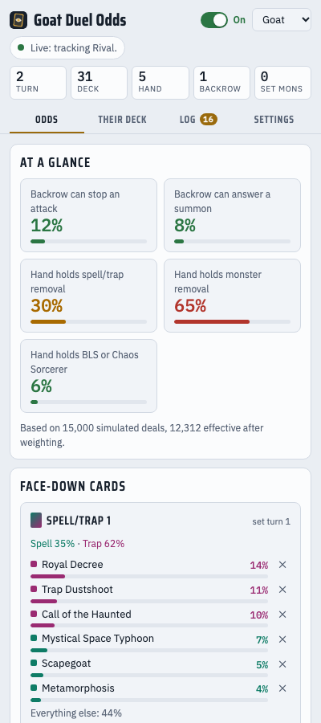
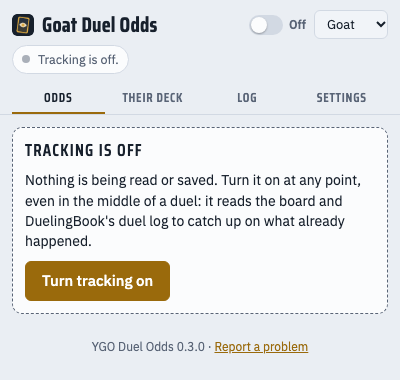
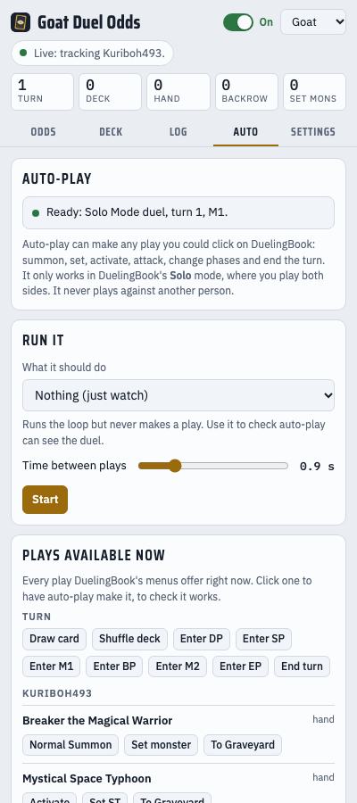

# YGO Duel Odds

A helper for playing Yu-Gi-Oh! **Goat** and **Edison** format on [DuelingBook](https://www.duelingbook.com/). It sits next to your duel and shows the odds for what your opponent might have: each face-down card, their hand, their next draw, and which deck they're playing. It updates on its own as you play. You don't have to type anything in.



### [⬇ Download YGO Duel Odds](https://github.com/Kuriboh493/ygo-duel-odds/releases/latest/download/ygo-duel-odds.zip)

For Chrome, Edge, Brave, Opera, Vivaldi and Firefox. Using Safari on a Mac? [Download the Safari version](https://github.com/Kuriboh493/ygo-duel-odds/releases/latest/download/ygo-duel-odds-safari.zip) instead.

Then follow the [install steps](#install-it-about-5-minutes) below. It takes about 5 minutes.

It only uses what both players can see on screen. It never peeks at your opponent's hidden cards. Some tournaments don't allow helper tools, so check the rules before using it in an event.

It can also **play for you**. Flip the **AI takes over** switch in the **Auto** tab and a model trained on real decks, or on your own duels, makes the plays: in Solo Mode, in labeled bot duels, or in any unrated duel where the opponent types **yes** when it asks if they'll play your AI. It never plays for you against someone who thinks they're playing you.

**Turn on the AI in 3 steps:**

1. [Install the extension](#install-it-about-5-minutes) and open the panel on DuelingBook.
2. In the **Auto** tab, under **Learning**, press **Load a trained model** and pick `models/goat-starter.json` from the [full project download](https://github.com/Kuriboh493/ygo-duel-odds/archive/refs/heads/main.zip).
3. Start a Solo Mode duel and flip **AI takes over** to On. To have it play people, set up [bot duels](#bot-account-playing-people-who-choose-to-play-a-bot) first.

Flip it off, or press **Stop**, to take control back. [More about the switch](#the-ai-takes-over-switch).

- [Install it (about 5 minutes)](#install-it-about-5-minutes)
- [Use it](#use-it)
- [Turning it on partway through a duel](#turning-it-on-partway-through-a-duel)
- [Auto-play](#auto-play)
  - [The "AI takes over" switch](#the-ai-takes-over-switch)
  - [Playing on your own account](#playing-on-your-own-account)
  - [Asking in any duel](#asking-in-any-duel)
  - [Pace and DuelingBook's slow-play rules](#pace-and-duelingbooks-slow-play-rules)
- [Bot account: playing people who choose to play a bot](#bot-account-playing-people-who-choose-to-play-a-bot)
- [Something not working?](#something-not-working)
- [What it can and can't see](#what-it-can-and-cant-see)
- [For developers](#for-developers)

## Install it (about 5 minutes)

It works in **Chrome, Edge, Brave, Opera, Vivaldi**, **Firefox** and **Safari** on a Mac. Safari has [its own steps](#safari-on-a-mac). It isn't in any browser's add-on store yet, so there's no one-click install. You download a folder and point your browser at it, and the steps below walk through that.

### Step 1: Download it

1. Click this link: **[Download YGO Duel Odds](https://github.com/Kuriboh493/ygo-duel-odds/releases/latest/download/ygo-duel-odds.zip)**. A file called `ygo-duel-odds.zip` downloads, usually into your Downloads folder.
2. Unzip it:
   - **Windows:** right-click the file, choose **Extract All**, then **Extract**.
   - **Mac:** double-click the file.
3. You now have a folder called `ygo-duel-odds`. Leave it somewhere you won't delete it, like your Documents folder: the browser runs the extension from this folder.

### Step 2: Add it to your browser

**Chrome, Edge, Brave, Opera or Vivaldi**

1. Open a new tab and type the address for your browser into the address bar, then press Enter:
   - Chrome: `chrome://extensions`
   - Edge: `edge://extensions`
   - Brave: `brave://extensions`
   - Opera: `opera://extensions`
   - Vivaldi: `vivaldi://extensions`
2. Turn on **Developer mode**. It's a switch in the top-right corner of the page. In Edge it's on the left.
3. Click **Load unpacked**.
4. Find the **`ygo-duel-odds`** folder, click it once, and click **Select** (or **Open**).
5. "YGO Duel Odds" now appears in the list. It may show a yellow "warnings" note. That's expected and safe to ignore.
6. Pin it so it's easy to find. Click the puzzle-piece icon next to the address bar, then the pin next to "YGO Duel Odds". Its icon is a card with an eye on it.

**Firefox** (version 128 or newer)

1. Type `about:debugging#/runtime/this-firefox` into the address bar and press Enter.
2. Click **Load Temporary Add-on…**.
3. Open the `ygo-duel-odds` folder and pick the file called **`manifest.json`**.
4. Firefox only keeps add-ons installed this way until you close Firefox. Each time you reopen it, repeat these three steps.

**Safari:** see [Safari on a Mac](#safari-on-a-mac) below. It has its own download.

### Step 3: Open the panel

1. Go to [duelingbook.com](https://www.duelingbook.com/). If it was already open, reload the page so the extension can start.
2. Click the extension's icon, the card with an eye. A panel opens on the side of the window. In Firefox it's the sidebar. In browsers without a side panel, it opens as a small window.
3. **Firefox only:** if the panel says it can't see DuelingBook, click **Allow access to DuelingBook**, then reload the DuelingBook page.
4. Pick **Goat** or **Edison** from the menu in the top-right of the panel.

That's it. Start or watch a duel and the panel fills in by itself.

### Safari on a Mac

Safari installs extensions as a small Mac app. This one isn't signed with a paid Apple developer account, so macOS and Safari each ask you to confirm it once. You also have to tick one Safari setting each time you open Safari.

1. **Download:** [Download the Safari version](https://github.com/Kuriboh493/ygo-duel-odds/releases/latest/download/ygo-duel-odds-safari.zip). A file called `ygo-duel-odds-safari.zip` downloads. Double-click it to unzip it.
2. **Move it:** drag **YGO Duel Odds** (the app) into your **Applications** folder.
3. **Open the app once.** macOS will say it can't check the app for malicious software, because it isn't signed. To open it anyway:
   - **macOS 14 (Sonoma) or older:** hold **Control**, click the app, choose **Open**, then click **Open** again.
   - **macOS 15 (Sequoia) or newer:** double-click the app and close the warning. Open **System Settings** > **Privacy & Security**, scroll down, and click **Open Anyway** next to "YGO Duel Odds". Enter your password if asked.

   A small window opens. It's only the installer, so you can close it.
4. **Turn on unsigned extensions in Safari.**
   - Open **Safari** > **Settings** > **Advanced** and tick **Show features for web developers**.
   - A **Developer** tab appears in Settings. Open it and tick **Allow unsigned extensions**, then enter your password. On Safari 16 or older, this is in the **Develop** menu instead.
5. **Turn the extension on:** in Safari's **Settings** > **Extensions**, tick **YGO Duel Odds**.
6. **Allow it on DuelingBook:** go to [duelingbook.com](https://www.duelingbook.com/), click the extension's icon in the toolbar, and choose **Always Allow on This Website**.
7. **Open the panel:** click the icon again. In Safari, the panel opens in its own small window. Put it next to your DuelingBook window.

**Each time you reopen Safari**, it switches off "Allow unsigned extensions" again, so repeat step 4. The extension stays installed, and turns back on when you tick that box. Only an extension signed through Apple's paid developer program avoids this step.

## Use it

### The on/off switch

The switch at the top of the panel turns tracking on and off.

- **On** (green): it follows the duel and keeps the odds up to date.
- **Off** (grey): it reads nothing and saves nothing. The toolbar icon shows **OFF**, so you can tell at a glance.



You can switch it on whenever you like, including in the middle of a duel. See [Turning it on partway through a duel](#turning-it-on-partway-through-a-duel).

### The four tabs

- **Odds**: what you need mid-duel.
  - **At a glance** has the big risks: whether their face-down spells or traps can stop an attack or answer a summon, and whether their hand holds removal.
  - **Face-down cards** lists each card they've set, with the cards it's most likely to be.
  - **Their hand** lists what they're likely holding. Cards you saw them add to their hand are marked "known".
  - **Their next draw** lists the cards they're most likely to draw next.
- **Their deck**: the deck they're most likely playing, the cards it usually runs, and a place to paste their decklist if you have it.
- **Log**: everything the extension has noticed, in order, newest first. The number on the tab counts new entries.
- **Auto**: [auto-play](#auto-play), which can make plays for you in Solo Mode or on a bot account, with one switch to hand it control.
- **Settings**: the "no response" options, tracking options, and **Report a problem**.

### Reading the numbers

- **"Royal Decree 14%"** under a face-down card means: out of every 100 situations that match everything seen so far, that card is Royal Decree in about 14.
- **"Holds one+ 25%"** in their hand means a 1-in-4 chance they're holding at least one copy.
- **Red** means likely, **orange** means maybe, and **green** means unlikely.

The numbers sharpen as the duel goes on and they show more of their deck.

### "What they didn't do"

When you attack, summon, or activate a spell or trap and your opponent doesn't respond, that's a clue. They probably don't have a card that would have stopped it. The extension notices this by itself and lowers the odds of those cards. The adjustment appears as a small tag under the face-down card, such as "Auto: Ignored an attack 70%".

- To undo one, click its tag.
- To rule out a card for one face-down card, click the **✕** next to that card.
- The buttons under **What they didn't do** on the Odds tab are for things the extension can't see, like "Left my backrow alone".
- You can turn the automatic version off, or make it stronger or weaker, in **Settings**.

### If you know their decklist

You don't need it, because the extension guesses their deck as they play. If you do have it:

1. Open the **Their deck** tab and click **Opponent decklist**.
2. Paste the list, one card per line (like `3 Book of Moon`), or click **Open a .ydk or text file**.
3. Click **Load list**.

To go back to guessing, choose **Guess it from what they play** in the same place.

## Turning it on partway through a duel

Switch it on at any point, or open the panel mid-duel, and it catches up by itself:

1. It reads the board as it is right now: their hand and deck size, every face-down card, and everything in the graveyard and banished.
2. It reads DuelingBook's own **Duel Log** for this game. Any card your opponent showed earlier counts as part of their deck. A card they added to their hand, and haven't used since, is marked as probably still in their hand.
3. The earlier plays show up in the **Log** tab, marked "Earlier".

There are two things it can't recover from before you switched it on:

- **"No response" moments.** It doesn't know which of your attacks they let through earlier. You can add these by hand with the buttons under **What they didn't do**.
- **Earlier face-down cards.** It doesn't know whether a card in their hand was once set face-down.

A note at the top of the Odds tab tells you when this happens.

## Auto-play

The **Auto** tab can make plays on DuelingBook for you: draw, summon, set, activate, attack, change phases and end the turn. It makes them through DuelingBook's own menus, exactly as if you'd clicked them.



### Where it plays, and where it doesn't

| Where | Does it play? |
|---|---|
| A **Solo Mode** duel, where you play both sides yourself | Yes. |
| A **bot account** (its name contains "bot"), against someone who joined its labeled, unrated bot duel | Yes, once you've set it up. See [Bot account](#bot-account-playing-people-who-choose-to-play-a-bot). |
| **Your own account**, against someone who joined its labeled, unrated bot duel | Yes, if you choose **My own account** under **Bot account**. See [Playing on your own account](#playing-on-your-own-account). |
| **Your own account** in any other unrated duel: pool duels, challenges, duels you host yourself | Only if you tick **Ask opponents in my other unrated duels too**, and the opponent types **yes** when it asks in chat. See [Asking in any duel](#asking-in-any-duel). |
| A **rated** duel, or any duel where the opponent hasn't agreed | **No, never.** It's locked and refuses every play, because that opponent thinks they're playing you. |
| Watching someone else's duel | No. |

The DuelingBook page itself enforces the lock, not just the panel, so no setting in the panel can get around it.

### The "AI takes over" switch

The switch at the top of the **Auto** tab hands control to the AI. While it's on, the learned model plays whenever auto-play is allowed to play, and you don't have to press anything else.

**Set it up once:**

1. **Load a model.** In the **Auto** tab, under **Learning**, press **Load a trained model** and pick one. If you haven't trained your own yet, use the starter model, `models/goat-starter.json`, from the [full project download](https://github.com/Kuriboh493/ygo-duel-odds/archive/refs/heads/main.zip). See [Teaching it to play like you](#teaching-it-to-play-like-you) to train one on your own duels. The model stays loaded until you remove it.
2. **For bot duels only:** under **Bot account**, choose which account it plays on and tick the confirmations. See [Bot account](#bot-account-playing-people-who-choose-to-play-a-bot). Skip this if you only want it in Solo Mode.

**Then, each time, flip the switch to On.** What happens next depends on where you are:

- **In a Solo Mode duel:** it starts playing straight away, as player 1 (or both sides, if you chose that under **Which side it plays**). When the duel ends it waits, and it takes over again as soon as you open the next Solo Mode duel.
- **Logged in as your bot account,** or as yourself with **My own account** chosen: it turns on bot account mode, opens the Duel Room, hosts its labeled, unrated duel, accepts whoever joins, announces in chat that it's a bot, plays the duel, and hosts again afterwards. It keeps going duel after duel.
- **Logged in as your own account, with a separate bot account chosen, and not in Solo Mode:** it does nothing, and says it's waiting. It never plays here.

The line under the switch always tells you what it's doing:

| It says | What it means |
|---|---|
| Playing this Solo Mode duel. | It has control. |
| Playing on the bot account. | It has control, and is playing or hosting bot duels. |
| Playing labeled bot duels on your account. | The same, on your own account. |
| Waiting: open a Solo Mode duel, or log in as your bot account. On any other account it never plays. | It's on, but you're somewhere it isn't allowed to play. |
| Waiting: load a trained model under Learning. | It has nothing to play with. Load a model. |
| Waiting: this is a bot account, but bot account mode is off. Confirm the checklist under Bot account. | Tick the three confirmations under **Bot account**. |
| Waiting: open a Solo Mode duel, or confirm the checklist under Bot account to host bot duels on your account. | You chose **My own account** but haven't ticked its two confirmations. |
| Waiting for the DuelingBook page. Open or reload it. | The panel can't reach DuelingBook. Reload the DuelingBook tab. |

**To take control back,** flip the switch to Off, or press **Stop** under **Run it**. Either one stops it mid-turn and switches it off, so it doesn't take straight back over. In bot duels it also stops hosting new duels, and if a bot duel is under way it says so in chat and admits defeat, so the opponent isn't left waiting.

**Keep the panel open.** The AI runs in the panel. If you close the panel, it stops playing, and in a bot duel it admits defeat after 20 seconds. It remembers that the switch is on, and it carries on when you open the panel again.

The switch only ever uses the **Learned model**, and the [safety rules](#safety-rules) below always apply.

### Running it by hand

If you'd rather control each step, leave the switch off and use **Run it**. Under **What it should do** you can choose:

- **Learned model (plays like you)**: makes the plays a model trained on your own recorded duels thinks you'd make. See [Teaching it to play like you](#teaching-it-to-play-like-you).
- **Nothing (just watch)**: runs but never plays. Use it to check that auto-play can see the duel.
- **Test: draw, then end the turn**: on player 1's turns it draws a card and ends the turn, to check that plays go through.

To try it:

1. On DuelingBook, start a **Solo Mode** duel.
2. Open the **Auto** tab. The box at the top should say **Ready: Solo Mode duel**.
3. Under **Plays available now**, click any play. Auto-play makes it on DuelingBook, so you can see it working.
4. Or pick a setting under **What it should do**, choose how long to wait between plays with **Time between plays**, and press **Start**. Press **Stop** at any time.

Everything it does, including every play, every refused play and why, and every time it takes over or stops, is listed under **What it did**.

### Teaching it to play like you

The learned model copies your decisions. You record your own duels, train a model on your computer, and load it back into the extension. It learns from what you did in each situation, so the more duels you record, the better it gets. It isn't a general Yu-Gi-Oh! AI: it can only make the kinds of plays it has seen you make.

**1. Record your plays.** In the **Auto** tab, under **Learning**, turn on **Record my plays for training**. Then play duels as normal, in any mode. Each play you make is saved on your computer, along with the situation you made it in: your cards, and whatever both players could see of your opponent's. It never saves your opponent's hidden cards. The count under the switch shows how many plays are saved. A few hundred plays is a start, and a few thousand is better.

**2. Download them.** Press **Download training data**. A file called something like `ygo-training-data-2026-10-29.json` downloads.

**3. Train the model.** This needs Python 3, which Macs and most Linux computers already have. On Windows, install it from [python.org](https://www.python.org/downloads/). The trainer isn't in the extension download, so get the full project too: [download it from GitHub](https://github.com/Kuriboh493/ygo-duel-odds/archive/refs/heads/main.zip) and unzip it. Open a terminal in that `ygo-duel-odds-main` folder and run:

```
python3 tools/train_policy.py ~/Downloads/ygo-training-data-2026-10-29.json
```

It takes a few seconds to a few minutes. When it finishes, it tells you how often the model picked the play you actually made, in duels it didn't train on, and how that compares to guessing. It writes a file called `policy.json`.

**4. Load it.** Under **Learning**, press **Load a trained model** and pick `policy.json`. Then choose **Learned model** under **What it should do**, start a Solo Mode duel, and press **Start**.

**No recordings yet?** Load the ready-made starter model, `models/goat-starter.json`, from the [full project download](https://github.com/Kuriboh493/ygo-duel-odds/archive/refs/heads/main.zip). It was trained on simulated games between real tournament decks, taught by a player that looks ahead (see below). In 1,000 test games against the scripted player it won 51% and lost 46%, with 3% reaching the turn limit. Against the look-ahead teacher that taught it, it won 41%.

Or train your own from simulated games. `tools/sim_goat.py` deals games between Goat decks and writes every decision as training data. By default it uses four standard lists in `tools/decks/` (Chaos Control, Gumo Warrior, Warrior and Chaos Turbo from the 2026 World Championship season). With `--fl 400` it deals from the 400 most recent decks that placed in tournaments on Format Library instead, which `tools/train_decks.py` downloads.

Two players can make the plays:

- The **scripted player** (default) uses common rules of thumb. It's fast, and a model trained on it learns those habits.
- The **look-ahead teacher** (`--teacher rollout`) tries each legal play in copies of the game, with the cards it can't see dealt again at random each time, plays each copy on for a few turns with the scripted player, and keeps the play that does best. It wins about 60% of games against the scripted player. It's slower: about 130 games a minute on 8 cores. It also records the value it found for each play (`cvals`), which the trainer can use as soft targets (`--soft-temp`); that's off by default because it made models play more passively.

```
python3 tools/sim_goat.py --fl 400 --teacher rollout --games 1000 -o teacher.json
python3 tools/train_policy.py teacher.json -o policy.json
```

A model only ever sees the positions its teacher gets into, so once you have a model, let it make the plays while the teacher labels them, and train on both files. The model then learns what to do in the spots it gets itself into:

```
python3 tools/sim_goat.py --fl 400 --teacher rollout --actor policy.json --epsilon 0.1 --games 600 -o dagger.json
python3 tools/train_policy.py teacher.json dagger.json -o policy.json
```

A model trained on your own duels will play more like you. You can train on recorded duels and simulated games together.

To see how a model plays, rather than how often it copies, test it against the scripted player, the teacher, or another model:

```
python3 tools/sim_goat.py --fl 400 --eval --games 500 --model policy.json
python3 tools/sim_goat.py --fl 400 --eval --games 500 --model policy.json --opponent old-policy.json
```

Under **Which side it plays**, choose whether it plays only player 1, or both sides against itself.

### Safety rules

These always apply, whether you use the switch or **Start**:

- It only plays where the table in [Where it plays](#where-it-plays-and-where-it-doesnt) says it can.
- It only makes plays that DuelingBook's own menus offer right now, and waits at least 0.3 seconds between plays.
- It never makes a kind of play the model has never seen made.
- It makes each card's play at most once per turn, so each monster attacks at most once.
- Once it ends its turn, it waits for the next one, and it ends the turn after 40 plays.
- In bot duels, it only plays its own cards on its own turn, and keeps the pace described in [Pace and DuelingBook's slow-play rules](#pace-and-duelingbooks-slow-play-rules).

### Playing on your own account

You can let the AI play on your own account, but only in labeled bot duels. Choose **My own account** under **Bot account**, tick its two confirmations, and flip the switch. It then works exactly like a bot account: it hosts unrated duels titled as bot duels, only plays people who join one, and tells them in chat before its first play: "Hi! I'm a bot: a computer program trained to play this format, playing on its owner's account, as this duel's title says."

It never plays anyone who hasn't agreed to play a bot. In pool duels, challenges and duels you host yourself, the opponent thinks they're playing you, so it only plays them if it has asked and they've said yes. See [Asking in any duel](#asking-in-any-duel).

Two things to know before you use it:

- **Your name doesn't say it's a bot.** Opponents only find out from the duel's title and the chat message. Saying so in your profile while it runs helps.
- **It's your main account at risk.** [DuelingBook's rules](https://www.duelingbook.com/rules) don't mention bots either way, but staff "reserve the right to ban or suspend accounts at our discretion with or without warning", and you're responsible for everything done on your account. If they decide they don't like it, the account banned is the one with your rating and history. A separate bot account keeps that risk off your main one.

To play yourself again, flip the switch off. With asking off, any duel you host afterwards is yours: the bot never accepts joiners into a duel that isn't titled as a bot duel.

### Asking in any duel

Tick **Ask opponents in my other unrated duels too** under **Bot account**, and keep the **AI takes over** switch on. Then play as you normally would: join the pool, send or accept challenges, or host your own duels. When an unrated duel starts, the bot asks in chat:

> Heads up: my owner would like their AI, a computer program, to play this duel for them. Type yes to play the bot, or no to play them instead.

- **They type yes** (or "y", "yeah", "yep", "sure", "ok"): it thanks them, reminds them it's a bot, and plays the duel. If they answer during rock-paper-scissors, it handles that too.
- **They type no:** it replies "No problem! My owner will play this duel themselves." The panel shows a message and adds it to **What it did**, and you play the duel.
- **They don't answer:** it never plays. The panel shows "Asked the opponent in chat. Waiting for them to type yes.", so play the duel yourself.
- **They change their mind:** if they type no after saying yes, it stops straight away and hands the duel back to you, mid-turn if need be. Keep an eye on the duel.
- **Rated duels:** it never asks, and never plays them.

An answer only counts for that duel or match. Next time you meet the same person, it asks again. Only the opponent's own chat messages count, not yours or a watcher's.

On your own account with asking on, the switch doesn't open the Duel Room or host by itself, since you pick the duels. You can still host labeled bot duels with **Host a bot duel**, or tick **Host again after each duel**.

### Pace and DuelingBook's slow-play rules

DuelingBook's rules don't set a time limit for turns or responses. They ask both players to keep "a reasonable pace", and count these as slow play:

- AFK for less than 6 minutes is a warning. AFK for 6 minutes or more loses the game.
- Not answering within 30 seconds after a judge prompts you loses the game.
- Stalling on purpose to waste an opponent's time is cheating, and gets the account frozen.

DuelingBook doesn't give players automatic chances to respond, either. You respond by making a play. So in bot duels the AI paces itself to give opponents time to respond, without ever leaving them waiting:

| When | What it does |
|---|---|
| Between any two of its plays | Waits at least 1.5 seconds. |
| After a play an opponent might respond to (a summon, an activation, an attack, entering the Battle Phase) | Waits 3 seconds before its next play. Draws, sets, position changes and most phase changes don't need this. |
| While the opponent is making plays, such as chaining to its card | Waits until they've made no play for 3 seconds. |
| Stuck on its own turn for a minute, with no play going through | Ends its turn. |
| Still stuck a minute and a half after that | Says so in chat and admits defeat. |
| The panel stops running it mid-duel (closed, or switched off) | Admits defeat after 20 seconds, or straight away if you press **Stop** or flip the switch off. |
| Someone calls a judge | Posts a note in chat for the judge: it's a bot, it can't answer questions, its owner runs it, and its opponents joined a duel titled as a bot duel. |

What it can't do yet: it only plays on its own turn. If an opponent's card asks it to do something on their turn, such as discarding, it won't, and the opponent has to carry on or call a judge. It also can't answer a judge's questions, so a judge may rule a game loss for not responding. Watch its duels when you can.

## Bot account: playing people who choose to play a bot

Auto-play can also duel real people, but only people who know they're playing a program. The best way is a separate DuelingBook account set up as a bot, described here. It can also run on your own account under the same rules: see [Playing on your own account](#playing-on-your-own-account).

- **It's labeled.** The account's name must contain "bot", and its profile should say it's a bot and who runs it.
- **Opponents opt in.** It hosts its own unrated duels titled "🤖 BOT: you'll be playing YGO Duel Odds, a computer program. Unrated." It only plays people who join one of those duels.
- **It tells them in chat.** Before its first play of each game, it posts: "Hi! I'm a bot: a computer program trained to play this format, run by its owner to test it."
- **It never plays rated duels**, and never joins the matchmaking pools.
- **It only plays its own cards, on its own turn,** at a [reasonable pace](#pace-and-duelingbooks-slow-play-rules), and admits defeat rather than leave someone waiting.

If any of these isn't true, it refuses to make a play. For example, if you accept a pool duel or a challenge on the bot account yourself, it stays locked, because that opponent never saw its label.

Bots aren't covered by DuelingBook's rules either way, so ask DuelingBook's staff before running one. It's their site, and an account they don't approve of can be banned.

To run it:

1. Make a DuelingBook account for the bot, with "bot" in its name and a profile that says it's a bot run by you.
2. Ask DuelingBook's staff if it's OK.
3. Log in as the bot in DuelingBook. Open the **Duel Room** and pick the bot's deck there.
4. In the panel, open the **Auto** tab and go to **Bot account**. Under **Which account it plays on**, keep **A separate bot account**. Tick the three confirmations, then turn on **Bot account mode**. Tick **Host again after each duel** if you want it to keep going.
5. Press **Host a bot duel**. It hosts an unrated Goat match (or Edison, if Edison is picked at the top).
6. Under **Run it**, choose **Learned model**, and press **Start**.

From there it handles each duel itself: it accepts the first person who joins, plays rock-paper-scissors, goes first when it wins, posts its announcement, plays its turns with the model, and keeps its deck as it is between games. Keep the panel open while it runs. Everything it does is listed under **What it did**.

### Robot jokes in chat

With **Robot-from-the-future jokes in chat** ticked under **Bot account** (it's on unless you untick it), the bot's chat messages get a joke in the style of a killer robot sent back in time:

- **Its greeting** keeps the plain "Hi! I'm a bot: a computer program…" message first, so nobody misses that it's a bot, and swaps the usual sign-off for a joke, such as "Come with me if you want to duel." or "Scanning your deck... threat level: undetermined. Good luck, human."
- **Between games of a match** it posts one line, such as "Rebooting for the next game. I'll be back."
- **If it has to admit defeat** it says why with a joke, such as "Power cell critical. Admitting defeat rather than leave you waiting. Thanks for the game, human!"

That's at most three messages a game, so it isn't chat spam. Its note for a judge always stays plain. Untick the box for plain messages. The lines are `FUN_HELLO`, `FUN_SIDING` and `FUN_FORFEIT` in `extension/page-hook.js` if you want to add your own.

### Let it take over when the bot logs in

Once the three confirmations are ticked and a model is loaded, the [AI takes over](#the-ai-takes-over-switch) switch does everything above for you. Flip it on, and logging in as the bot is all it takes. It turns on bot account mode, opens the Duel Room, hosts its labeled duel, starts the learned model, and hosts again after each duel.

- With **A separate bot account** chosen, it only does this when the logged-in account's name contains "bot", so logging in to your own account does nothing.
- It hosts with the deck the Duel Room picks first, so make the bot's deck its default deck.
- Flipping the switch off, or pressing **Stop**, hands control back to you. It stops playing and stops hosting new duels.
- The panel has to stay open, as with every other auto-play mode.

A typical setup: keep your own account in one browser, and the bot account in another browser, or a separate browser profile, with the panel open and the switch on. Then the bot plays on its own while you play on your account as normal.

## Something not working?

| What you see | What to do |
|---|---|
| "Looking for a DuelingBook tab…" | Open [duelingbook.com](https://www.duelingbook.com/) in the same browser window. If it's already open, reload it. |
| "Connected… Waiting for a duel to start" | This is normal until a duel begins. Start or watch a duel. |
| "Tracking is off" | Flip the switch at the top of the panel to **On**. |
| Auto-play changes phases and attacks, but never summons, sets or activates cards | Update to the newest version and reload DuelingBook. Older versions clicked the card's menu item, but DuelingBook then waited for a zone to be clicked (when its **Choose zones** option is on), or ignored the click (when card counts are hidden). If it still happens, look under **What it did** for "DuelingBook didn't make …" and [report a problem](#reporting-a-problem). |
| "The extension can't see DuelingBook yet" (Firefox) | Click **Allow access to DuelingBook**, then reload the DuelingBook page. |
| "Duel events aren't coming through" | DuelingBook may have updated. The board is still read, but "no response" isn't logged automatically. Please [report it](#reporting-a-problem). |
| The extension disappeared (Safari) | Safari turns off unsigned extensions whenever it quits. In Safari's **Settings** > **Developer**, tick **Allow unsigned extensions** again ([step 4](#safari-on-a-mac)). |
| The extension disappeared (Firefox) | Firefox removes add-ons installed this way when it closes. Repeat [Step 2](#step-2-add-it-to-your-browser). |
| I want the newest version | Download it again from the [download link](https://github.com/Kuriboh493/ygo-duel-odds/releases/latest/download/ygo-duel-odds.zip), replace your old `ygo-duel-odds` folder with the new one, then click the circular-arrow **reload** button on the extension in your browser's extensions page. |
| The numbers look wrong | Open **Settings** and click **Restart tracking from the current board**. If it's still wrong, [report it](#reporting-a-problem). |
| The panel is blank or stuck | Close the panel and open it again. If that doesn't help, reload DuelingBook. |

### Reporting a problem

Click **Report a problem** at the bottom of the panel.

1. Describe what went wrong in a sentence or two.
2. Check what's attached. It's a summary of what the extension saw: versions, recent errors and the last few plays. Player names are swapped for "Me" and "Opponent" unless you untick that box.
3. Choose how to send it:
   - **Open a GitHub issue**: opens a filled-in report on the project page. Read it, then press **Submit**. You need a free GitHub account.
   - **Copy report**: copies it so you can paste it into a message to whoever gave you the extension.
   - **Download report**: saves it as a file you can send.

Nothing is sent until you do one of these.

## What it can and can't see

It reads only what DuelingBook shows to both players:

- How many cards your opponent has in their hand and deck.
- Every face-down card's position.
- Every card that's face-up, in the graveyard or banished.
- Cards they reveal, or add to their hand where both players can see them, such as a search.
- DuelingBook's public duel log.

It never reads the names of cards in your opponent's hand, or of face-down cards that haven't been shown to both players. It doesn't read passwords, account details or private messages. Everything stays in your browser, except the decks from your past duels, which it keeps on your computer to make better guesses.

How the deck guess works: the extension learned what Goat and Edison decks look like from about 3,500 decklists that placed in tournaments, plus about 2,500 decklists people have posted online. Tournament decks count the most. During a duel, every card your opponent shows narrows down which of those decks they're likely playing. Decks you've faced before count too, and an earlier game against the same opponent counts the most.

## For developers

### What's in the repository

| Path | What it is |
|---|---|
| `extension/` | The browser extension (Manifest V3: Chromium, Firefox 128+, and Safari through `tools/build_safari.sh`). |
| `goat-odds.html`, `edison-odds.html` | The original single-page calculators. You log what the opponent does by hand. Open either in a browser, with `cards.js` in the same folder. Keyboard shortcuts: D draw, S set spell/trap, M set monster, E end turn, Z undo. |
| `cards.js` | Card database built from the YGOPRODeck API. `extension/cards.js` is a copy. |
| `tools/build_cards.py` | Builds `cards.js`. |
| `tools/train_decks.py` | Learns the deck archetypes in `extension/learned.js`. |
| `tools/make_icons.py` | Draws the toolbar icons. |
| `tools/build_safari.sh` | Builds the Safari app with Xcode. The GitHub workflows run it on a macOS runner. |
| `tools/train_policy.py` | Trains the auto-play model from recorded decisions. |
| `tools/test_features.py` | Checks that the Python and JavaScript copies of the model's features match. |
| `tools/sim_goat.py` | A simplified Goat simulator that writes training decisions from a scripted player, and tests a trained model against that player. |
| `tools/decks/` | The four standard decklists the simulator uses. Add more `.txt` lists in the same format and it uses them too. |
| `models/goat-starter.json` | A model trained on 3,200 simulated games between Format Library topping decks, labelled by the look-ahead teacher (a quarter of them with an earlier model making the plays), ready to load in the Auto tab. |

### How the extension works

- **`page-hook.js`** runs in DuelingBook's page context. It wraps the client's `duelResponse()`, through which every duel event passes, and reads the board from the client's `player1` and `player2` objects. It passes on only public information: names of face-up and revealed cards, never names from hand or face-down cards. It also returns the public text of the client's `duel_logs` when asked.
- **`tracker.js`** is a content script. It keeps the public identity of each card instance and the numbering of face-down cards. It detects "no response" by opening a window after your attack, summon or spell/trap activation, which closes on your next action or on any play by the opponent. When tracking starts partway through a duel, it catches up from `duel_logs`:
  - Every quoted card name in the opponent's lines is counted as at least one copy in their deck. Lines about targeting or attacking are skipped, because they name the other player's cards.
  - A card sent "to hand" and not mentioned since is softly marked as known in their hand. The mark moves off when they play a copy of it.
- **`panel.js`** runs the model and draws the panel.
  - With no decklist, the opponent's deck is a mixture of archetypes from `learned.js` and decks from your past duels. Each archetype gives every card a distribution over 0–3 copies.
  - Each card shown reweights the archetypes and updates copy counts through a binomial model of how much of the deck has been seen.
  - Each of 15,000 simulated deals samples a whole deck, conditioned on the deck size DuelingBook shows. It then deals the hidden cards with importance weights from the face-down and hand evidence.
- **Auto-play** has two halves:
  - `page-hook.js` is the executor. It lists the plays on offer by running the client's own menu builders (`cardMenuE`, `showDeckMenu`) with `showMenu` briefly swapped for a recorder, so nothing appears on screen. It makes a play the way a click does, through `cardMenuClicked`. Attacks on a monster go through `Send` with the chosen target, and phase plays use `Send` directly.
  - The executor refuses anything that isn't on that card's menu right now, and anything less than 300 ms after its last play. Outside Solo Mode, it refuses everything unless bot account mode's conditions all hold:
    - The account's name contains "bot", or the panel chose own-account mode (`bot.own`, from `settings.botKind`).
    - The duel is unrated (`rated === false`).
    - The opponent joined a duel the bot hosted under its label. `joinDuelResponse` is wrapped to accept joiners and record them, and only while the Host form's note is still the bot label.
    - The bot's announcement has been sent for this game.

    In bot duels it only plays its own cards on its own turn. `botWait` refuses plays with `wait: true` (which the panel retries quietly) inside 1.5 s of its last play, 3 s after a play that isn't in `QUIET_PLAYS`, and 3 s after any opponent play. `botPace` ends a stuck turn after 60 s and admits defeat through the client's `admitDefeat` after 90 s more, or once the panel's heartbeat (`moves` with `beat`) has been missing 20 s; the panel also sends `botForfeit` when it stops mid-duel. A `Call admin` event posts a note for the judge. With `bot.ask`, `botTick` posts `BOT_ASK` once in any other unrated duel and `botChat` reads the opponent's `Duel message` replies into `chatYes`/`chatNo`; `agreed()` accepts either a labeled-duel joiner or a yes, and every agreement is cleared when the client leaves the duel. The hook also answers rock-paper-scissors, picks first and confirms side decking, all through the client's own `chooseRPS`, `pickFirst`, `doneSiding` and `hostDuel`.
  - When recording is on, `page-hook.js` builds a decision record just before the client applies each of your plays. The record holds:
    - your cards with names and stats
    - the opponent's public cards, plus counts of their hidden ones
    - the turn, phase, and how many plays and summons you've made this turn
    - every candidate play, with a key
    - which candidate you chose

    `tracker.js` stores the records in chunks, capped at 40,000.
  - `features.js` turns a record into features for each candidate: the play type crossed with the phase, zone, card name, hand size, board counts and life points, whether the attackers on board could finish them, plus battle outcome for attacks. `tools/train_policy.py` has a line-for-line Python copy, and `tools/test_features.py` checks the two agree using macOS's JavaScript engine. Records keep the raw situation rather than features, so the features can change without re-recording. Bump `FEATURES_VERSION` in both when they do.
  - `train_policy.py` fits a linear softmax ranker over each decision's candidates with AdaGrad and L2, holding out 20% of duels. It streams the data file, so it can train on millions of decisions in a few hundred MB. Decisions that carry the teacher's value for each play (`cvals`) can be trained as soft targets, weighted by how clearly the best play won (`--soft-temp`, `--adv-scale`; both off by default, since they made models more passive). It reports top-1 and top-3 accuracy against random and most-common-play baselines, and on teacher data how often its pick was among the teacher's best, then refits on everything and exports the weights. No packages are needed.
  - `tools/sim_goat.py` simulates games with the lists in `tools/decks/`, or with `--fl N` the N most recent Format Library topping decks:
    - It models turns, tributes, battle and the effects of about a hundred of the most-played Goat cards, simplified. Cards it doesn't know play as vanilla.
    - It handles DuelingBook's manual follow-ups, like the two draws after Pot of Greed and the discards after Graceful Charity.
    - The defending player's traps follow fixed habits.
    - The scripted player's decisions are written as records, with candidates named as DuelingBook's menus name them.
    - `--teacher rollout` makes the recorded plays with a look-ahead player: each legal play is tried in copies of the game with the hidden cards redealt, played on for `--horizon` turns by the scripted player, and scored by a fixed position value. The value it found for each play is recorded as `cvals`.
    - `--actor policy.json` has a model make the plays while the teacher labels them (DAgger), with `--epsilon` random plays mixed in.
    - `--model policy.json --eval` plays the trained model against the scripted player (or `--opponent rollout`, or another policy.json), using the same guards as the extension, and reports the win rate. Runs use all cores (`--jobs`).

    It's a rough model of the game, not a rules engine: chains are one link deep, and effects outside those decks do nothing.
  - `autoplay.js` runs the loop in the panel. A strategy is an entry in `STRATEGIES` with a `decide(state)` function that returns an action or `null`. The comment at the top of the file lists what `state` holds and what an action looks like. The "AI takes over" switch is `settings.botAuto`: `takeoverTick` checks every 3 seconds and starts the learned model when the page reports a Solo duel or a bot account in bot account mode. It only reads the lock the page hook reports, so it can't unlock anything. In bot account mode the same setting tells the hook to open the Duel Room and host, and `botPause` stops the hosting when the switch goes off.
- **`report.html`** gathers diagnostics from the panel and the DuelingBook tab, and opens a prefilled GitHub issue.

If DuelingBook changes its client, the panel says duel events aren't coming through. Board reading may keep working in that case.

### Releasing a new version

1. Raise `version` in `extension/manifest.json`, for example to `0.3.1`, and commit.
2. Tag and push: `git tag v0.3.1 && git push origin v0.3.1`.

The `Release` GitHub workflow checks that the tag matches the manifest. It then attaches two files to a release for that tag: `ygo-duel-odds.zip`, which is `extension/` zipped, and `ygo-duel-odds-safari.zip`, the Safari app built on a macOS runner. The README's download links always point at the newest release. The `Safari build` workflow also builds the Safari app on every branch push that changes the extension, and keeps it as a downloadable artifact on the run.

Safari doesn't support `world: "MAIN"` content scripts. When `page-hook.js` hasn't answered 1.5 seconds after load, `tracker.js` injects it from a web-accessible script tag instead. Safari also ignores `sidePanel`, `side_panel` and `sidebar_action`, so the toolbar button opens the panel in a window, or a tab if that fails.

### Refreshing the card database

```
curl -o cardinfo.json https://db.ygoprodeck.com/api/v7/cardinfo.php
python3 tools/build_cards.py cardinfo.json cards.js
cp cards.js extension/cards.js
```

Common staples use hand-tuned values in `extension/formats.js` and the two calculator pages. For every other card, the chance it gets set and its tags are guessed from its text: stops attacks, answers summons, removal, negation, hand trap.

### Retraining the deck archetypes

```
python3 tools/train_decks.py            # uses cached decklists if there are any
python3 tools/train_decks.py --refresh  # downloads the published decklists again
```

The script needs no extra packages. It fetches about one request a second. The first run downloads every topping decklist, roughly 3,500 of them, which takes about an hour. You can stop it at any time and rerun it, and it picks up where it left off. Everything is cached in `tools/.cache`.

It uses two sources:

- **Topping decks from Format Library.** These are tournament results labeled with their deck type. Each one counts as 4 published decks, with more for higher placements. Older events count for less, losing half their weight every 2 years. Each deck type with at least 8 topping decks becomes its own archetype.
- **Decks published on YGOPRODeck.** These are dropped if they have unknown cards, aren't 40 to 60 cards, include a card released after the format's cutoff, break the Goat banlist, or duplicate another deck.

A semi-supervised latent class model then fits a 0 to 3 copy distribution for every card in each archetype. Labeled topping decks train only their own archetype. Published decks are shared out among those archetypes and a few extra ones for decks that don't match a known type. The number of extra archetypes is picked by how well the model predicts held-out decks. Each archetype's starting weight in the panel is 80% its share of topping lists and 20% its share of published decks.
